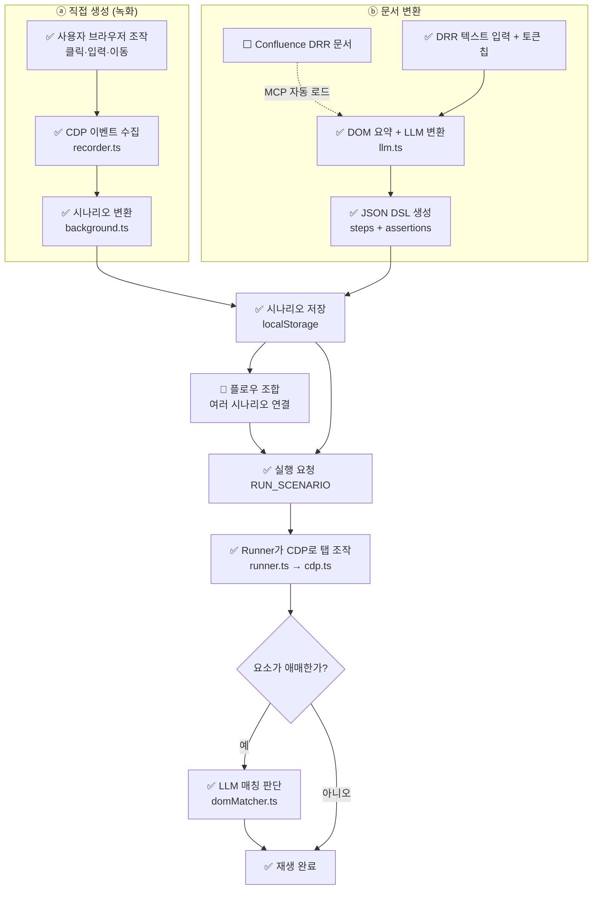

# aflow — 프로젝트 개요 및 LLM 활용

> DRR(Design Review Request) 문서를 실행 가능한 시나리오로 바꾸고, 브라우저에서 자동 재생하는 **Chrome 확장 프로그램**입니다.
> 이 문서는 사내 로컬 LLM을 활용하는 실제 사례로서 aflow를 소개합니다.

---

## 1. 개요

- **플랫폼**: Chrome Extension (Manifest V3, DevTools Side Panel)
- **브라우저 제어**: Chrome DevTools Protocol(CDP)
- **LLM 활용**:
   - 자연어 →  구조화된 테스트 시나리오 변환
   - 실행 중 DOM 요소 매칭 및 판단
- **기술 스택**: React 19, TypeScript, Vite, Tailwind CSS 4, Radix UI, React Flow
- **데이터 저장**: localStorage, chrome.storage (서버 DB 미사용)

**해결하는 문제**: 디자인/기획이 작성한 리뷰 문서를 사람이 매번 손으로 클릭하며 확인하는 대신, 문서를 그대로 **자동 재생**해 시연·검증한다. 반복 데모와 회귀 확인의 수작업을 없애는 것이 목적이다.

---

## 2. 동작 흐름

시나리오를 만드는 방법은 **두 갈래**다 — ⓐ 사용자가 브라우저를 직접 조작해 녹화하거나, ⓑ DRR 문서를 LLM으로 변환한다. 두 흐름 모두 **시나리오로 저장된 뒤, 동일한 실행 엔진(CDP 재생)으로 합류**한다.

**범례**: ✅ 완료 · 🔶 부분 구현 · ⬜ 예정(점선)



- **ⓐ 직접 생성(녹화)**: 사용자의 실제 조작을 CDP 주입 스크립트로 캡처해 시나리오로 변환한다. LLM 없이 동작한다. *(완료)*
- **ⓑ 문서 변환**: DRR 텍스트를 입력하면 현재 페이지 DOM 요약을 붙여 LLM이 JSON DSL로 변환한다. 앞단의 **Confluence MCP 자동 로드**는 예정 단계다. *(변환 완료 / MCP 예정)*
- **합류 후 실행**: 두 흐름 모두 시나리오로 저장되고, `RUN_SCENARIO` → Runner가 CDP로 탭을 조작한다. 재생 시점 화면이 달라 요소가 애매하면(동적 목록·모달·Vue 재렌더링) 안정 selector → 텍스트+맥락 → **LLM 판단** → 사후확인 순으로 찾는다. **플로우 조합**(여러 시나리오 이어 실행)은 부분 구현 상태다.

---

## 3. LLM 활용 — 지금, 그리고 앞으로

aflow에서 LLM은 두 성격이 다른 작업에 쓰인다. **OpenAI 호환 API(`/v1/chat/completions`)** 로 호출하므로, 사내 로컬 LLM(gemma 등)을 base URL·모델명만 바꿔 그대로 사용한다.

> 참고: 시나리오를 만드는 두 방법 중 **직접 생성(녹화)은 LLM을 쓰지 않는다**(브라우저 조작을 그대로 기록). LLM은 아래 ①②, 즉 **문서 변환 흐름과 재생 중 매칭**에서만 쓰인다.

### 현재 사용 중

**① DRR → DSL 변환 (`services/llm.ts`)** — *무거운 생성 작업*
- **입력**: 자연어 DRR 문서 + 페이지 DOM 요약(CTA·폼 필드·셀렉터, PII 마스킹) + 사용자 토큰 힌트
- **출력**: 엄격한 JSON (`name`, `baseUrl`, `steps[]`, `assertions[]`)
- **프롬프트**: 1,200줄 이상의 시스템 프롬프트에 액션 카탈로그·DOM 활용 규칙·텍스트/컨텍스트 결정 규칙 포함
- **특성**: 온도 0.2, 긴 컨텍스트(DOM 요약 최대 200K자), JSON 출력 강제

**② DOM 요소 매칭 판단 (`services/domMatcher.ts`)** — *가벼운 분류 작업*
- **입력**: 압축된 후보 요소 N개 + 찾으려는 의도(버튼 텍스트/폼 라벨 + 맥락)
- **출력**: 후보 중 하나의 selector, 또는 `NOT_FOUND` / `NOT_SURE`
- **특성**: 온도 0, `max_tokens` 200, 짧고 잦은 호출. 코드 기반 매칭으로 좁혀지지 않을 때만 폴백으로 호출
- **비활성 옵션**: 매처 호출을 끄고 코드 매칭만 쓸 수 있음(사내망 정책 대응)

> 두 작업의 부하 성격이 다르다: ①은 요청당 큰 프롬프트를 한 번, ②는 작은 프롬프트를 재생 스텝마다 여러 번 호출한다.
---

## 4. 아키텍처

### 레이어 구조

```
background.ts (Service Worker)  ─── 메시지 허브: RUN_SCENARIO, START/STOP_RECORDING, PAUSE/RESUME/CANCEL
   ├── engine/runner.ts         ─── 시나리오 스텝 순차 실행, 체인 실행, 새 탭 자동 전환
   ├── engine/recorder.ts       ─── 사용자 조작 녹화 (CDP 주입 스크립트로 이벤트 수집)
   ├── engine/cdp.ts            ─── CDP 래퍼 (attach 참조 카운팅, 대기 전략, 조작 프리미티브)
   ├── engine/actionRegistry.ts ─── 액션 이름 → 실행 함수 디스패치
   ├── actions/                 ─── 액션 구현 (navigation / interaction / auth / assertion)
   ├── services/llm.ts          ─── ① DRR → DSL 변환
   ├── services/domMatcher.ts   ─── ② 텍스트/AI 기반 DOM 요소 매칭
   └── services/domSnapshot.ts  ─── 페이지 DOM 요약 수집 (CTA·폼·PII 마스킹)

app/ (React SPA, Side Panel UI)
   ├── pages/ScenarioList.tsx     ─── 메인: 시나리오 목록, DRR 입력, 녹화
   ├── pages/ScenarioRunner.tsx   ─── 실행 화면 (진행 상태, 제어, 화면 녹화)
   ├── pages/ScenarioFlowPage.tsx ─── 플로우 빌더 캔버스 (React Flow)
   └── pages/FlowDetailPage.tsx   ─── 플로우 상세·실행

stores/ (localStorage / chrome.storage)
   ├── scenarioStore.ts         ─── 시나리오 CRUD           (localStorage: flux_scenarios)
   ├── settingsStore.ts         ─── LLM provider·키·속도     (localStorage: flux_*)
   ├── flowCompositionStore.ts  ─── 플로우 그래프(노드+엣지) (localStorage: flux_saved_flows_v1)
   ├── groupsStore.ts           ─── 시나리오 그룹            (localStorage: flux_groups)
   ├── selectorCacheStore.ts    ─── 성공 selector 학습 캐시  (chrome.storage.local)
   └── domCaptureStore.ts       ─── 실행 중 DOM 스냅샷        (chrome.storage.session)
```

### 핵심 설계 포인트

- **UI ↔ 엔진 통신**: `chrome.runtime.sendMessage` 기반. Runner는 각 스텝 후 `RUNNER_STATUS`를 브로드캐스트하고 UI가 수신.
- **재생 안정성**: "녹화 시점 화면 ≠ 재생 시점 화면" 간극을 메우기 위해, 불안정 selector(`_uid_`, 다중 `:nth-`)는 신뢰하지 않고 텍스트/맥락/AI로 폴백.
- **저장 이원화**: 사용자 데이터·설정은 `localStorage`(UI 컨텍스트), 러너/매처가 background에서 접근하는 캐시·스냅샷은 `chrome.storage`.
- **시나리오 조합의 수렴**: followUp 선형 체인(`lib/scenarioChain.ts`)과 React Flow 그래프(`lib/flowLinearPath.ts`) 두 방식 모두 최종적으로 `scenarios[]` 배열 → `runScenarioChain`으로 수렴.

---

## 5. 기능 현황

| 기능 | 상태 |
|---|---|
| DRR → DSL 변환 (LLM) | ✅ 동작 (OpenAI / Anthropic / 로컬 LLM) |
| 시나리오 실행 (CDP 재생) | ✅ 동작 |
| 녹화 (사용자 조작 → 시나리오) | ✅ 동작 |
| 검증 모드 (요소 존재만 순차 확인) | ✅ 동작 |
| 화면 녹화 (실행 과정 영상 저장) | ✅ 동작 |
| 플로우 조합 (그래프·체인) | 🔶 기본 동작, 편집 제약 있음 |

> 미구현 액션은 대부분 특정 서비스에 특화된 것으로, 정의(설계도)만 있고 실행부가 아직 없다.

---

## 6. TODO

- [ ] 시나리오 조합 기능 강화
   - 여러 시나리오를 이어 붙여 하나의 플로우로 실행. 그래프 편집·분기 UX 안정화
- [ ] 주소별 시나리오 확인
   - 현재는 검사 탭이 해당 주소에 있어야 시나리오가 목록에 보임(host+경로 필터). 주소로 이동하지 않고도 도메인 무관하게 조회·관리할 수 있게 개선
- [ ] Confluence MCP 연동 및 문서 자동 변환 (최종 목표)
   - Confluence MCP로 DRR 문서를 직접 읽어와, 복붙 없이 LLM이 곧바로 시나리오로 변환

---

## 7. 빌드 & 실행

```bash
pnpm install      # 의존성 설치
pnpm run dev      # Vite dev 서버
pnpm run build    # vite build + manifest.json → dist/
```

빌드 후 `chrome://extensions` → 개발자 모드 → `dist/` 폴더 로드 → DevTools(F12) → **"aflow"** 탭에서 사용.

**LLM 설정**: 확장 설정에서 provider(로컬 LLM / GPT-4o / Claude) 선택 후, 로컬 LLM은 Base URL·Model ID를 입력한다. OpenAI 호환 엔드포인트면 그대로 연동된다.

---

## 8. 참고 문서

- `README.md` — 재생 안정성 전략(요소 매칭·모달 스코프 등) 상세
- `docs/DEVELOPMENT.md` — 개발 상세, 기술 스택
- `docs/FLOW_COMPOSITION_DESIGN.md`, `docs/WORKFLOW_DESIGN_DRAFT.md` — 플로우/워크플로우 설계 초안
