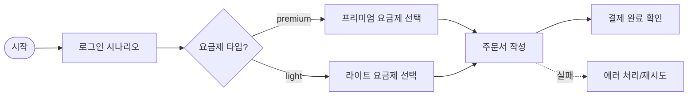
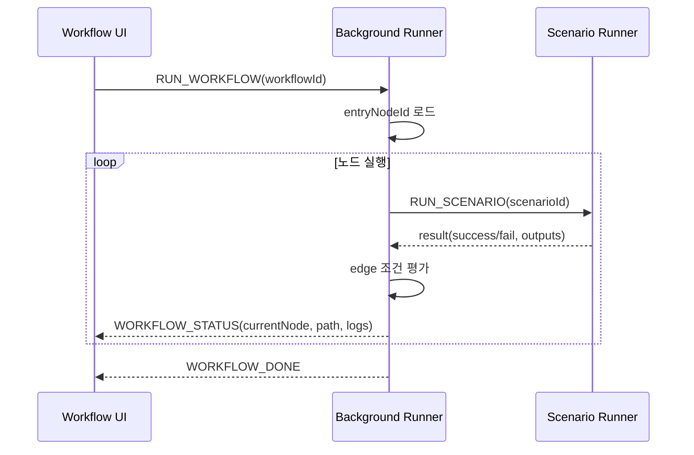

# flux Workflow Builder Draft

## 목적

기존 단일 `Scenario` 실행 방식을 확장하여, 여러 시나리오를 연결한 분기형 테스트 워크플로우를 구성한다.

- 시나리오 재사용: 로그인/상품선택/결제 등 공통 시나리오를 노드로 재조합
- 분기 실행: 조건(성공/실패/표현식)에 따라 다음 노드 결정
- 가시성: 실행 경로를 다이어그램으로 확인

## 정보 구조

- `Workflow`: 전체 그래프
- `WorkflowNode`: 실행 가능한 단위(기존 `scenarioId` 참조)
- `WorkflowEdge`: 노드 간 연결 + 분기 조건
- `RunContext`: 실행 중 생성/누적되는 값(예: `vars.planType`)

```ts
type EdgeConditionType = "always" | "onSuccess" | "onFail" | "expression";

interface Workflow {
  id: string;
  name: string;
  entryNodeId: string;
  nodes: WorkflowNode[];
  edges: WorkflowEdge[];
  createdAt: string;
}

interface WorkflowNode {
  id: string;
  scenarioId: string;
  title: string;
  position: { x: number; y: number };
}

interface WorkflowEdge {
  id: string;
  fromNodeId: string;
  toNodeId: string;
  conditionType: EdgeConditionType;
  expression?: string; // conditionType === "expression"
  label?: string;
}
```

## 화면 레이아웃(초안)

### 1) 좌측: 시나리오 라이브러리

- 검색 입력 + 태그 필터
- 시나리오 카드 목록 (드래그로 캔버스 추가)
- 카드 정보: 제목, 태그, 최근 검증 결과

### 2) 중앙: 워크플로우 캔버스

- 노드/엣지 시각화
- 노드 선택/이동/삭제
- 엣지 연결(노드 포트 드래그)
- 실행 중 현재 노드 하이라이트 + 경로 강조

### 3) 우측: 속성 패널

- 노드 선택 시: 연결된 시나리오, 설명, 실행 옵션
- 엣지 선택 시: 조건 타입, expression, 라벨 편집
- 저장/취소 액션

## UX 상태

- `edit`: 편집 가능 (드래그/연결/삭제)
- `run`: 편집 잠금 + 실행 진행 상태 표시
- `inspect`: 특정 실행 기록 리플레이 모드

## 실행 규칙(MVP)

1. `entryNodeId`부터 실행
2. 노드 실행 결과를 `success | fail`로 수신
3. 현재 노드의 outgoing edge 중 아래 우선순위로 다음 노드 결정
   - `onSuccess` 또는 `onFail`
   - `expression` (true 평가)
   - `always`
4. 매칭되는 edge가 없으면 워크플로우 종료

## 예시 워크플로우



## 실행 시퀀스(개념)



## 컴포넌트 초안

- `WorkflowBuilderPage`
- `ScenarioLibraryPanel`
- `WorkflowCanvas`
- `NodeCard`
- `EdgeEditorPanel`
- `WorkflowRunTimeline`

## 저장소/러너 확장 초안

- `src/stores/workflowStore.ts`
  - CRUD: create/update/delete/list
- `src/engine/workflowRunner.ts`
  - 그래프 순회 + 조건 평가 + 상태 브로드캐스트
- `src/background.ts`
  - `RUN_WORKFLOW`, `PAUSE_WORKFLOW`, `CANCEL_WORKFLOW` 메시지 핸들러

## 단계적 구현 제안

### Step 1 (MVP)

- 노드 추가/삭제/이동
- 엣지 연결
- 조건 타입 `always | onSuccess | onFail`만 지원
- 실행 상태 하이라이트

### Step 2

- `expression` 조건 지원
- 변수(`vars`) 패널 + 디버그 로그
- 실패 분기 재시도 정책

### Step 3

- 워크플로우 템플릿
- 실행 이력/리플레이
- 병렬 분기(필요 시)

## 설계 포인트

- 동적 selector 이슈를 줄이기 위해, 노드 단위 재사용은 기존 시나리오 안정성 개선과 같이 진행
- 워크플로우는 시나리오를 대체하지 않고 상위 오케스트레이션 레이어로 유지
- 표현식 평가기 도입 시 보안 제약(허용 문법 제한) 필요
